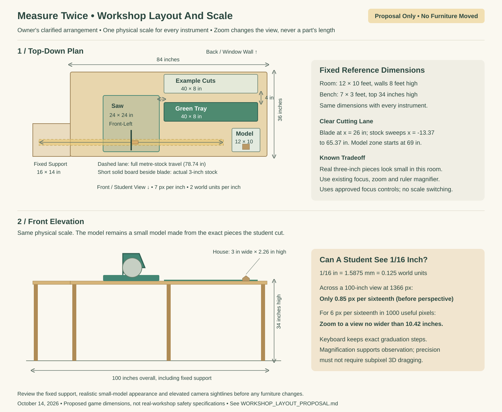

# Workshop Layout And Scale Proposal

**Review proposal only. No furniture, plank profile or physical-scale changes from this proposal are implemented.** This uses the owner's clarified October 14 arrangement: saw front-left, green tray in the center, a rectangular example/comparison area behind the tray, and the assembly model front-right. It supersedes the earlier two-by-two suggestion. The camera recovery, contrast and room-surface fixes are separate approved refinements.

## Exact Current Mapping

The arithmetic is internally consistent: one inch is two world units; one millimetre is 1/12.7 world units. Physical records use 2,032 integer ticks per inch: a sixteenth is 127 ticks and a millimetre is 80. Plank and model lengths use the same mapping. Zoom changes the camera, not those dimensions.

The surroundings do not use realistic reference dimensions. Their toy proportions make a three-inch board look several feet long. Under the current mapping:

| Existing Object | World Units | Implied Physical Size |
| --- | --- | --- |
| 3-inch stock | 6 long, 0.22 thick, 0.63 wide | 3 × 0.11 × 0.315 inches |
| Main bench top | 19.05 × 4.56; top about 3.93 above floor | 9.525 × 2.28 inches; top about 1.965 inches high |
| Saw base | 2.1 × 2.05 | 1.05 × 1.025 inches |
| Small-instrument room | 54 wide × 48 deep; walls 18 high | 27 × 24 inches; walls 9 inches high |
| Metre stock | 78.740157 long | 39.370079 inches / exactly 1 metre |
| Metre comparison table | 79.340157 wide | 39.670079 inches; 42 legs |

The long-instrument problem comes from growing furniture with stock length. The moving stock spans both sides of the saw; the metre's lane reaches 157.48 units (78.74 inches) across its complete travel. The comparison table is stock length plus 0.6 world units and gains supports every four units. It is not a failed conversion or an accumulation of old tables. The gray bar beside the long ruler is its horizontal scrollbar.

## Proposed Single Physical Scale

Keep the current exact tick arithmetic and **two world units per inch for every instrument**. Give the surroundings plausible, fixed reference dimensions. These are proposed game dimensions, not a specification for building or safely operating a real workshop:

| Proposed Reference | Inches | World Units |
| --- | --- | --- |
| Room | 144 × 120; walls 96 high | 288 × 240; walls 192 high |
| Main bench | 84 × 36; top 34 high | 168 × 72; top 68 high |
| Fixed left stock support | 16 × 14; same support level | 32 × 28 |
| Saw footprint / approximate height above bench | 24 × 24 / 14 | 48 × 48 / 28 |
| Green tray zone | 40 × 8 | 80 × 16 |
| Examples/comparison zone | 40 × 8 | 80 × 16 |
| Model zone | 12 × 10 | 24 × 20 |

The full footprint is 100 inches wide including the fixed left support. This is about 8 feet 4 inches, not an instrument-dependent banquet table. A full metre sweeps from -13.37 to 65.37 inches relative to the bench's left edge when the blade is at x = 26 inches. The fixed support covers the left overhang; the right endpoint remains clear of the model zone beginning at x = 69 inches. This support is a proposed geometry change, requiring approval with the layout. No new interaction is proposed.

The blade/stock lane sits 30 inches from the rear edge. The 40-inch tray and example zones hold a full metre without intruding into the saw footprint. The fixed support must meet the stock-bearing level of the saw. Tray and examples lie behind that lane, separated by four inches, and the saw footprint ends two inches before the tray. The model sits to the front-right. Keep the current palette, models and interaction loop. A fixed small set of supports replaces formula-driven dozens of legs only after this plan is approved.

## What Realistic Scale Means For The Models

The existing models are small wooden models, not full-size furniture: House is about 3 × 2.259 × 1.518 inches; Plane 3 × 1.753 × 2.313; Chair 1.503 × 2.243 × 0.945; Tree 1.75 × 2.18 × 1.5 (width × height × depth). At realistic room scale they should look small. Do not enlarge the assembled model independently of its measured pieces. Preserve the existing Cut and Build focus choices, ruler magnifier, inspection closeup and exact keyboard steps, and retarget their camera positions to the revised physical anchors if approved.

## Sixteenth-Inch Visibility

The smallest imperial graduation is exactly 1/16 inch = 1.5875 mm = 0.125 world units. For a straight-on view spanning the proposed full 100-inch work area, its theoretical screen width is just 0.85 pixels at 1366 pixels wide, or 1.20 pixels at 1920. If only 1,000 pixels are useful after overlays, it is 0.625 pixels. Oblique perspective can reduce this further. A wide workshop view therefore cannot support reliable pointer discrimination of every physical sixteenth.

To give a sixteenth six pixels, a straight-on 1,000-pixel useful view must cover at most 10.42 inches; at 1366 pixels the limit is 14.23 inches. An existing closeup/zoom can provide that observational view. Zoom changes apparent size while the physical length and keyboard step remain fixed. This can support noticing scale and comparing endpoints; it is not a measure of fine motor accuracy. The separate ruler magnifier and graduation-aligned keyboard controls remain the precision inputs, so students are not required to drag to subpixel positions in the 3D scene.

The pixel figures are geometric upper bounds, not measurements from a proposed implementation. The current review build frames the cutting area on an explicit instrument switch and adds the separately approved click-to-focus shortcut. Exact input steps are preserved; the proposed fixed-dimension room is not implemented. A future approved layout needs laptop checks of all presets, longest/shortest cuts, three-dimensional pointer projection, reduced motion, collision and assembly transitions at the new anchors.

## Review Decision And Sources

Review this arrangement and fixed reference scale together before furniture work. In particular, confirm that the small model appearance, fixed left support and existing zoom/focus workflow are acceptable. The front elevation shows the intended saw/model height relationship; a low front view can still hide low examples behind the tray, so the normal view should remain elevated and oblique. No per-instrument physical scaling or new interaction is proposed.

Measurements come from src/workshop.js, src/layout.js, src/instruments.js, and the actual oriented 0.22 × 0.63 plank boxes in src/recipes.js / src/construction.js. The diagram is a planning artifact, not a game screenshot or an accepted redesign. Furniture, exact arithmetic, model geometry and instrument-dependent layout remain unchanged in this PR pending review.
