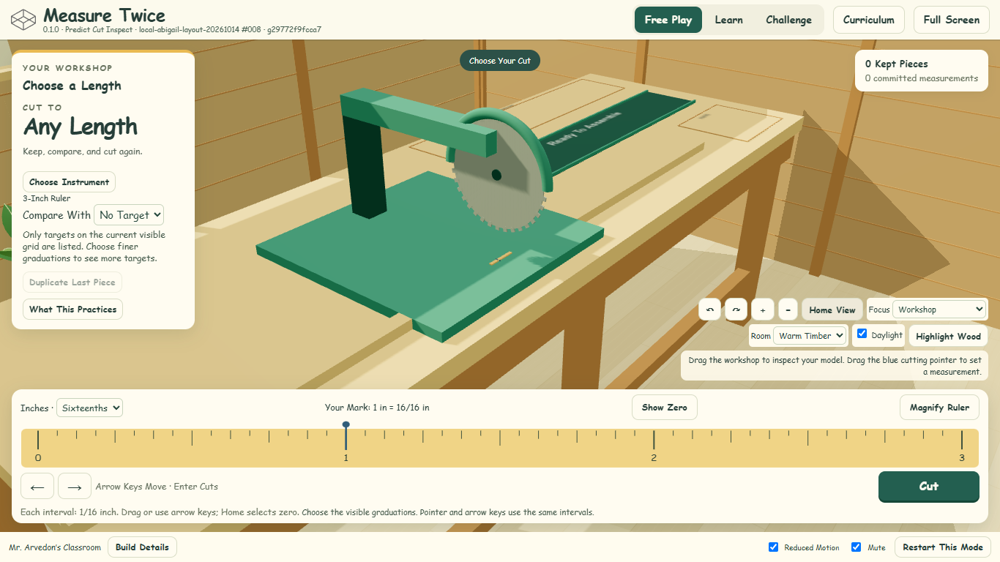
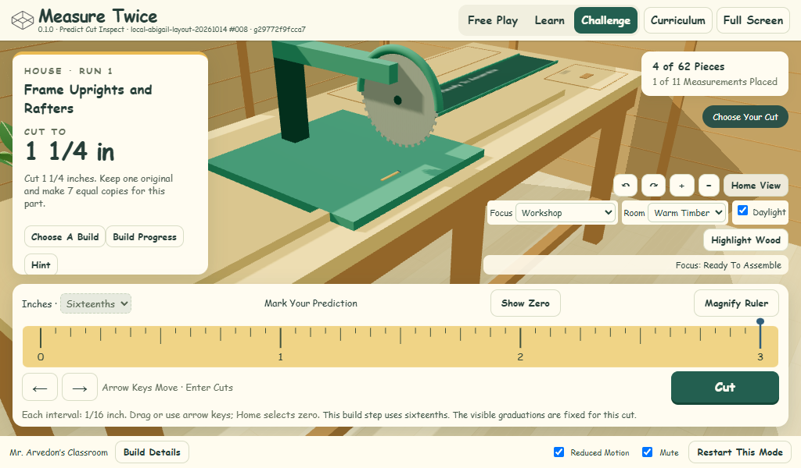
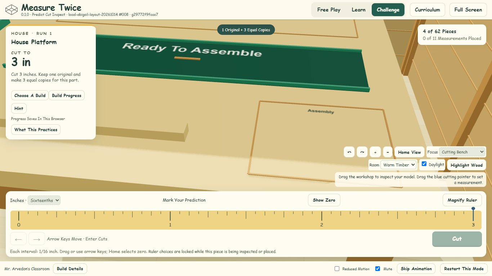
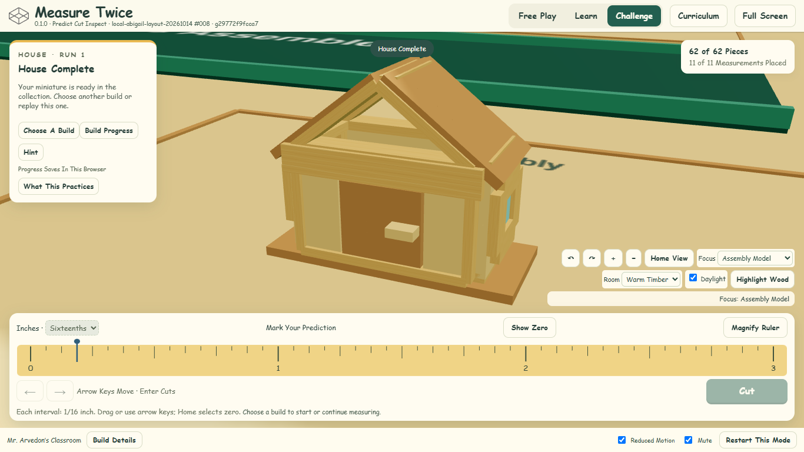

# Fixed Workshop Layout Evidence

The owner approved trying this layout after PR #36 merged. See [Implementation And Dimensions](../../docs/WORKSHOP_LAYOUT_REVIEW.md). This is a new review branch from merge 0b2f288678c2a419e66c475cf8228fd87a453a76; no merge or deployment was performed.

## Play And Inspect

- Abigail local preview: http://127.0.0.1:18448 (local to that computer).
- [Download The Review ZIP](0.1.0_Predict-Cut-Inspect_local-abigail-layout-20261014_build-008_20261014T235044Z_g29772f9fcca7_web.zip). Extract the complete folder and run Start Review.cmd with Node available; the included launcher also recognizes Abigail's bundled runtime.
- [Immutable Manifest](build-manifest.json), [ZIP Verification](archive-verification.json), [Served-Byte Verification](local-server-verification.json), [Build Identity History](identity-verification.json).

Build: `0.1.0_Predict-Cut-Inspect_local-abigail-layout-20261014_build-008_20261014T235044Z_g29772f9fcca7_web`

Version 0.1.0; codename Predict Cut Inspect; scope local-abigail-layout-20261014; ordinal 8; built 2026-10-14T23:50:44.894Z; clean source `29772f9fcca7b833f5c9ee205ec251bbd72c0ce4`. Later evidence commits do not relabel this source. ZIP SHA-256: `be357fb09c4e7138bc7369b62ead7102c2d50d9d8829dd453dd514af2307ca24`. All 73 artifact files were compared byte-for-byte with the archive and local server. Public catalog build 005 remained unchanged when checked.

## Verified Behavior

- [42 Unit Tests](unit-tests.log) and [Original House Geometry](house-geometry.log): exact arithmetic, visible input grid, saved attempts, replay, once-only transitions and original part lengths.
- [Fixed Layout](layout-verification.json): seven instruments keep the same bench, six legs, room, tray and orbit limits. Full stock sweep remains supported; retained pieces keep exact length and scale. Central staging, comparison behind it, front-right assembly, focus views and 1024 × 600/1920 × 1080 framing are checked.
- [Workshop And Camera](workshop-polish-verification.json): two complete measured instrument/style cycles after GPU warmup; stable lights/resources, no fog, window/wall detail, preferred zoom recovery, click focus, pointer priority, cumulative drag, reduced motion and laptop access.
- [Catalog](catalog-verification.json): 4 complete models, 37 measurements and 114 exact parts; actual rendered models remain supported inside assembly and clear of saw, tray and stock bed. Saved/retried cuts and replays retained.
- [Access And Instruments](catalog-access-verification.json): ten Learn stages, all seven instruments, 1,008 camera positions, wrong cuts, visible graduations, magnification, keyboard, blue pointer and emulated touch.
- [Full Motion](weekly-cleanup-verification.json): 37 assembly cycles and 7659 sampled frames; stable visible/depth-enabled work surface, persistent Challenge ruler, unchanged placement counts and retained saves.
- [Polish And Identity](polish-verification.json): overlay clearance, viewport checks, held inspection and manifest identity. No page errors or unexpected external requests in these browser suites.

## Screenshots

Additional views: [Cutting Focus](layout-initial-cut.png), [Metre Stock](layout-metre-cut.png), [Metre Inspection](layout-metre-inspection.png), [Assembly Motion](layout-assembly-motion.png), [Plane](plane-complete-1366.png), [Chair](chair-complete-1366.png), [Tree](tree-complete-1366.png), [Log Room](workshop-inch-3-logs.png), [Learn On A Laptop](polish-learn-1280x600.png).

## Review Limits

Checks used isolated Chromium profiles and synthetic records on Abigail. Owner browser profiles and prior artifacts were preserved. No physical Chromebook/trackpad or classroom pilot is claimed. Model scale is intentionally small and consistent with the exact measurements; close focus and ruler controls supply usable detail. No new curriculum, question, save schema, release version or colleague message was added. Approval is still needed before merging or deploying.
